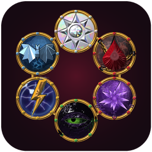
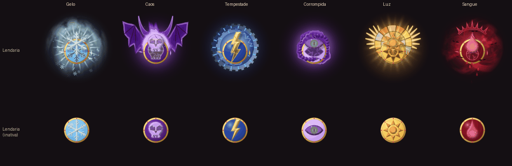
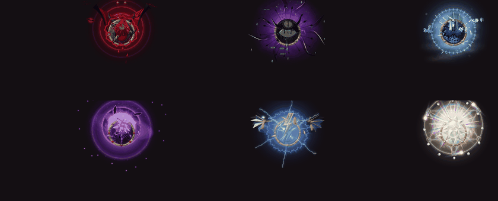
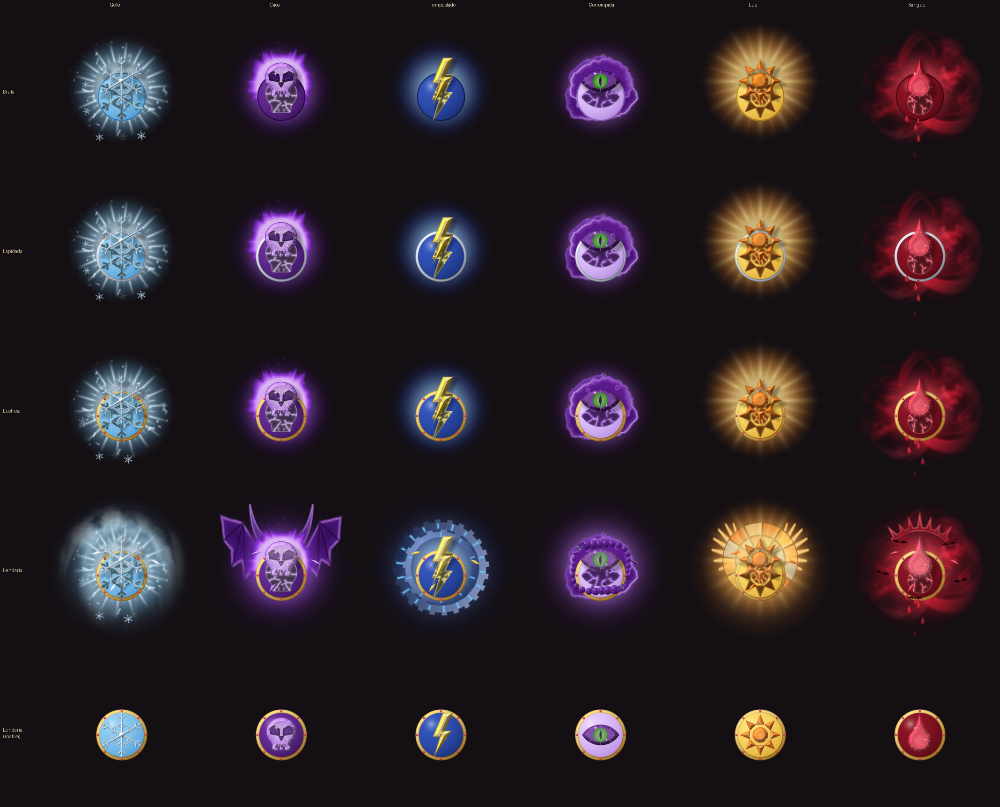

<p align="center"></p>

# CorrenteRapida

Mod de cliente (BepInEx) para o servidor **Sangria Falls** de V Rising. Adiciona uma barra com as seis **Correntes** do Draekhar ao lado do botão "Trocar de Corrente": **um clique troca de elemento, sem abrir a janela.**

<p align="center"></p>

## Novidades da 2.6.0

- **Joias em 3D**: as seis Correntes foram refeitas do zero, com joias lapidadas, encaixes esculpidos na pedra e um efeito Lendário permanente em cada uma.
- **Animação de abate**: o sangue ou a energia do inimigo que você abateu vai até a joia ativa, com uma animação diferente em cada elemento.
- **V Blood**: o abate de um V Blood absorve três vezes mais e termina numa explosão na joia.
- **Menu da engrenagem**: troca a cor do sol da Luminosa sem sair do jogo.

## Recursos

- **Troca com um clique** (botão esquerdo ou direito). O mod aperta os próprios botões "USAR" do ScarletInterface: nenhuma mensagem é forjada e recarga/bloqueios continuam sendo controlados pelo servidor.
- **Sem abrir a janela**: o mod guarda os botões e as ações da janela original e reaproveita depois, mesmo com ela fechada.
- **Detecta trocas manuais** feitas pela janela original.
- **Pré-carregamento invisível**: ao entrar no servidor, o mod abre e fecha a janela sem que ela apareça, para já conhecer os botões.
- **Prévia do Lendário**: segure **Alt** com o mouse sobre uma bola para vê-la no nível máximo, com uma legenda do tempo de uso.
- **Joias em 3D**: cada Corrente tem uma joia lapidada e renderizada em 3D, animada com ritmo próprio, assentada num encaixe esculpido na pedra. Quando ativa, a joia se solta do encaixe, solta um estouro do elemento e surge a aura.
- **Animação de abate**: quando você abate um inimigo que acertou, o sangue ou a energia dele voa até a joia ativa e é absorvido, de um jeito diferente em cada elemento. Abates de **V Blood** absorvem três vezes mais e terminam numa explosão na joia.
- **Leve**: cada joia é desenhada a partir de um único atlas, num Canvas próprio, com limite de quadros (a ativa a 40 fps, as encaixadas a 15 fps).
- **Espaço automático**: a barra abre o espaço necessário para a aura de uma joia nunca ficar em cima da vizinha.

| Corrente | Joia | Ritmo e aura | Lendária | Abate |
|---|---|---|---|---|
| Glacial | morcego de cristal num geodo de gelo escuro | energia presa tentando escapar da pedra, abrindo rachaduras brilhantes; coroa de estalactites | enxame de morcegos de gelo | a alma do alvo congela em cristais e um morceguinho de gelo a traz até a joia |
| Caos | estrela de plasma roxo, presa por correntes de magia | escapa e é puxada de volta; faíscas e fendas no espaço | buraco negro com disco de acreção sempre ativo | runas vampíricas em espiral, que orbitam e se acendem na joia |
| Tempestade | raio de citrino dentro de um globo de vidro | carga e descarga: relâmpagos caem na joia | asas de morcego de metal que funcionam como para-raios | o raio é arrancado do alvo; na Lendária ele cai nas asas e corre até a joia |
| Corrompida | olho de gosma viva que escorre e se mexe | pálpebra de gosma, filetes pingando, miasma | tentáculos e olhos na escuridão | tentáculos alcançam o alvo, agarram a gosma e a puxam |
| Luminosa | sol de diamante sobre uma pedra-da-lua opalina | halo, feixes prismáticos, mandala | coroa, mandala de diamantes e esferas de luz | runas sagradas e vampíricas, e a joia se incendeia em chama sagrada branca/arco-íris |
| Sanguínea | gota de rubi lapidada, acorrentada sobre uma poça de sangue | batimento de coração, veias pulsando | gola de vampiro, chifres, morcegos e olhos na escuridão | fitas de sangue extraídas do alvo, que serpenteiam até a joia |

<p align="center"></p>

### Animação de abate

Conta como seu o inimigo que você acertou e que morre até 12 s depois (40 s para V Blood), mesmo que o último golpe seja de um pet ou de outro jogador. Precisa haver uma Corrente ativa: a energia vai para a joia dela. Para desligar, use `AnimacaoAbate = false`.

A Luminosa tem várias animações de abate para escolher em `AbateLuz`: `Runas` (padrão), `Feixe`, `Fios`, `Cometas`, `Penas`, `Aureola`, `Morcegos` e `Constelacao`.

### Menu da engrenagem

A engrenagem ao lado da barra abre um menu para trocar a **cor do sol da Luminosa** (Diamante, Topázio dourado, Citrino, Champanhe ou Safira clara). As joias são geradas de novo em segundo plano, sem travar o jogo.

## Evolução por tempo de uso

Cada Corrente evolui conforme o tempo que você passa com ela ativa (pausa após 5 min sem mexer o mouse/teclado):

| Nível | Tempo | Visual |
|---|---|---|
| Bruta | 0 h | joia lapidada no encaixe da pedra |
| Lapidada | 1 h | lapidação fina, mais brilho |
| Brônzea | 2 h | aro de bronze |
| Prateada | 3 h | aro de prata |
| Dourada | 4 h | aro de ouro com gemas |
| Lustrosa | 5 h | aura mais intensa, mais partículas |
| Radiante | 20 h | luz interna pulsando e fragmentos orbitando |
| Lendária | 50 h | efeito lendário permanente do elemento (veja a tabela acima) |

<p align="center"></p>

Um anel fino em volta de cada bola mostra o progresso até o próximo nível. O tempo fica salvo só no seu PC, em `BepInEx/config/CorrenteRapida_tempo.txt`.

## Instalação

1. Tenha o **BepInEx 6 (IL2CPP)** e o **ScarletInterface** (já vêm com o launcher do Sangria Falls).
2. Baixe o `CorrenteRapida.dll` na página de [Releases](../../releases) e coloque em `BepInEx/plugins`.
3. Entre no servidor e abra a janela "Trocar de Corrente" uma vez pelo botão normal: o mod aprende onde ele fica e a barra aparece.

## Atualização automática

O mod consulta a última Release deste repositório ao abrir o jogo. Em `[Atualizacao] Modo`:

- **Automatico** (padrão a partir da 2.5.2): baixa a DLL nova, confere o SHA-256 publicado na Release e a instala; ela passa a valer na próxima vez que o jogo abrir.
- **Avisar**: mostra um aviso embaixo da barra quando há versão nova; clicando no aviso, ela é baixada e instalada.
- **Desligado**: não consulta nada.

O mod só baixa deste repositório, e tudo o que faz fica registrado no `LogOutput.log`.

## Configuração

Arquivo `BepInEx/config/sangria.correnterapida.cfg` (criado na primeira execução). Destaques:

| Opção | Padrão | O que faz |
|---|---|---|
| `Modo` (Atualizacao) | `Automatico` | `Automatico`, `Avisar` ou `Desligado` |
| `TrocaDireta` | `true` | troca sem abrir a janela |
| `PreCarregarJanela` | `true` | aprende os botões de forma invisível ao entrar no servidor |
| `IntervaloMinimo` | `1.2` | segundos mínimos entre duas trocas |
| `BotaoDireito` | `true` | permite trocar com o botão direito |
| `DeslocamentoX` / `DeslocamentoY` | `8` / `42` | posição da barra em relação ao botão original |
| `TamanhoBotao` | `44` | tamanho de cada bola |
| `EspacoAutomatico` | `true` | abre espaço para as auras não se sobreporem (`false` usa só o `Espacamento`) |
| `QuadrosJoiaAtiva` / `QuadrosJoiasEncaixadas` | `40` / `15` | limite de quadros das animações (`0` = sem limite) |
| `ForcarNivel` | `-1` | `0`–`7` força um nível para ver o visual (`-1` = tempo real) |
| `HorasNiveis` | `1,2,3,4,5,20,50` | horas para cada um dos 7 níveis |
| `MostrarProgresso` | `true` | anel de progresso em volta das bolas |
| `AnimacaoAbate` | `true` | animação de abate (sangue/energia do alvo indo para a joia) |
| `AbateLuz` | `Runas` | animação de abate da Luminosa |
| `CorLuz` | `Diamante` | cor do sol da Luminosa (também pelo menu da engrenagem) |

## Compilando

```bash
dotnet build -c Release
```

Por padrão as referências vêm do NuGet (`BepInEx.Unity.IL2CPP`, `VRising.Unhollowed.Client`). Para compilar contra as DLLs do seu próprio jogo, crie `libs/core` (cópia de `BepInEx/core`) e `libs/interop` (cópia de `BepInEx/interop`). A pasta `libs/` nunca deve ir para o repositório.

Toda a arte é gerada por código: `src/GemArt.cs` (camadas e animações) e `src/Gem3D.cs` (renderizador 3D em software das joias, metais e pedras). O projeto em `tools/preview` roda o mesmo código fora do jogo para gerar as prévias.

## Licença

[MIT](LICENSE). Mod feito por jogador, sem vínculo oficial com a Stunlock Studios ou com a equipe do Sangria Falls.
